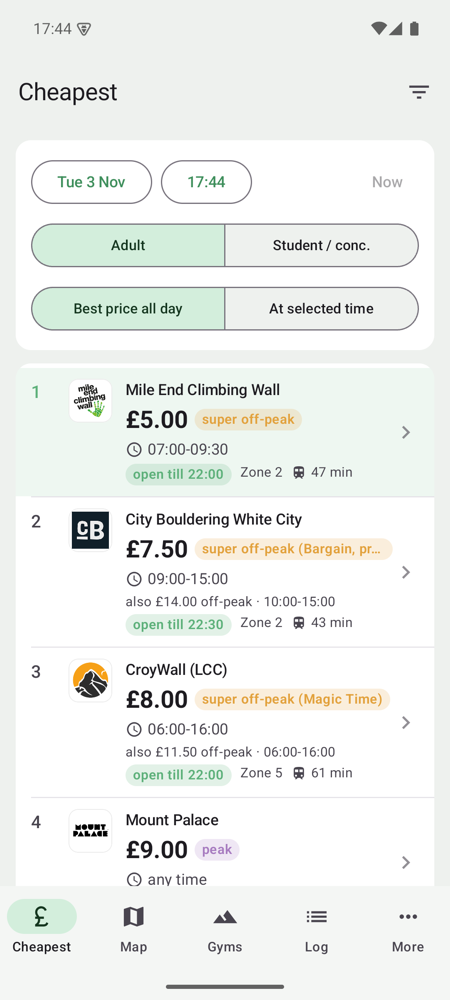
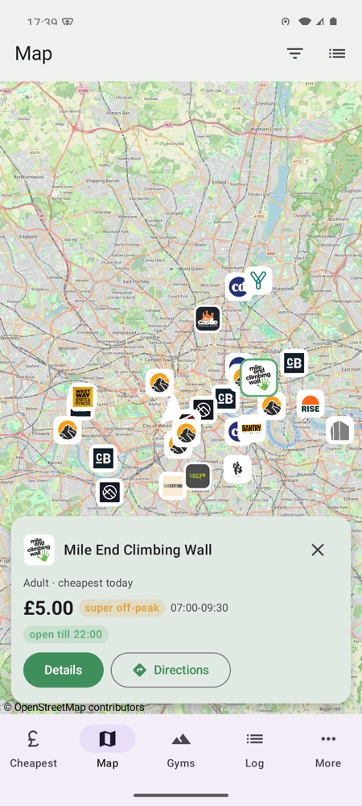
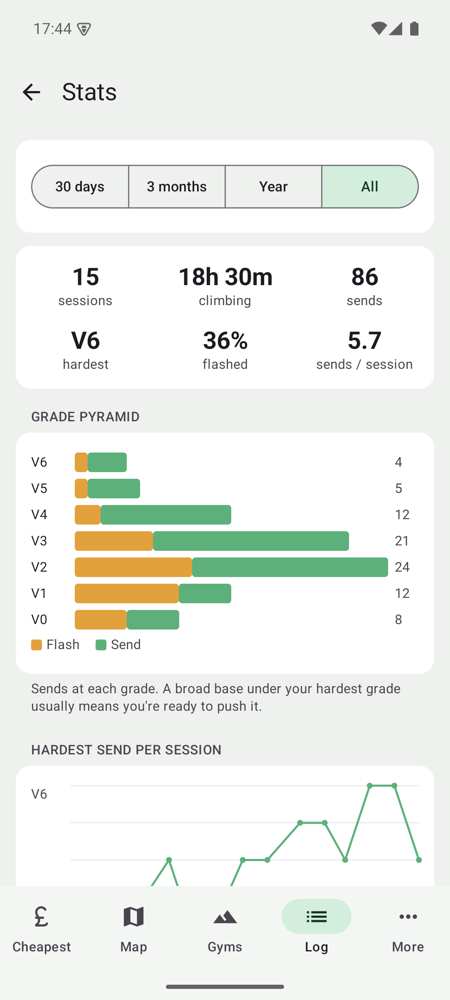

# London Climbing Finder — Android app

A native Android version of the site, written in Kotlin with Jetpack Compose. It matches
the [iPhone app](../ios/README.md): the same tabs, prices and logbook. It reads the same
`gyms.json`, built into the app so it works offline, and its pricing code is a port of
`assets/app.js`. `tests/test_pricing.py` checks that the Kotlin, Swift, JS and Python
pricing all agree.

<p align="center">
  
  
  
</p>

Tabs: **Cheapest**, **Map**, **Gyms**, **Log** and **More** (deals, memberships, classes,
socials, your location, logbook backup, Google Maps export). Each gym has a page with
prices, deals, opening hours, links, directions in Google Maps, and your own note, star
rating and favourite heart.

Not ported: the Live Activity, linking Photos to climbs (links made on an iPhone are kept
in backups but can't be opened here), and Google sign-in sync.

## Install it on your phone (no Mac needed)

You need the app file. On the phone, open this link to download it (no GitHub account
needed):

**https://github.com/Tutu2652/london-climbing-finder/releases/latest/download/london-climbing-finder.apk**

The [Releases page](https://github.com/Tutu2652/london-climbing-finder/releases) lists
every version.

1. Get the APK onto the phone: download it there, or download it on a computer and send
   it to yourself by email, WhatsApp or Google Drive.
2. Tap the file to open it. Android says installing apps from this source isn't allowed:
   tap **Settings**, turn on **Allow from this source**, then go back.
3. Tap **Install**. If Google Play Protect warns that it doesn't recognise the app, tap
   **More details → Install anyway**. It warns because the app isn't from the Play Store.
4. Open **Climbing Finder** from the app drawer.

The install doesn't expire, unlike the free iPhone install.

**Updates.** Install the newer APK over the top; your logbook and notes stay. This works
for any APK from Releases, CI or the maintainer, because they are all signed with the same key
(see [Signing key](#signing-key)). An APK someone built on their own computer has a
different key: Android then says "App not installed". To switch to it, back up your
logbook (More → Back up logbook), uninstall, install the new file and restore the backup.

**Google developer verification.** Google is starting to require that apps installed
from outside the Play Store come from a verified developer. It began in a few countries
(not the UK) in late 2026 and is due to reach every country in 2027. When it reaches the
UK, the app will need registering under a developer account. Google offers a free
"limited distribution" account for apps shared with a small group, which fits this app.
Until then, nothing changes.

## Build it

You need JDK 17 and the Android SDK (platform 35). Android Studio includes both; or
install a JDK and Google's command-line tools, then:

```sh
sdkmanager "platform-tools" "platforms;android-35" "build-tools;35.0.0"
cd android
./gradlew assembleDebug
```

The APK is at `android/app/build/outputs/apk/debug/app-debug.apk`. To put it on a phone
with a cable, turn on USB debugging (Settings → About phone → tap **Build number** seven
times, then Settings → System → Developer options → **USB debugging**), plug it in, tap
**Allow** on the phone, and run `adb install -r app/build/outputs/apk/debug/app-debug.apk`.
An AI coding agent can do this for you: ask it to "install the Android app on my phone"
([AGENTS.md](../AGENTS.md#installing-on-android) has the steps).

CI builds the same APK on every push and keeps it with the run for 90 days (Actions tab →
a green **CI** run → **climbing-finder-android**; needs a GitHub account). To publish a
new version, attach that APK to a new GitHub release, renamed to
`london-climbing-finder.apk` so the download link above keeps working.

### Signing key

Shared APKs are signed with one key, so each new one installs over the last. The key is
not in git. On the maintainer's Mac it is `~/.android/climbing-finder.jks`, and
`~/.gradle/gradle.properties` points to it:

```
climbingFinderKeystore=/Users/<you>/.android/climbing-finder.jks
climbingFinderKeystorePassword=<password>
```

CI reads the same key from two repository secrets: `ANDROID_KEYSTORE_BASE64` (the file,
base64-encoded) and `ANDROID_KEYSTORE_PASSWORD`. Builds without the key (a fork, or
someone else's computer) use Android's own debug key, which is different on every machine.

Keep a backup of the `.jks` file and its password, for example in a password manager. If
the key is lost, every friend has to uninstall and reinstall once.

## Tests

```sh
cd android && ./gradlew :core:test      # pricing and logbook unit tests
python3 -m unittest discover -s tests    # from the repo root: includes Kotlin parity
```

The parity test runs `./gradlew :core:parityDump` and compares every gym's prices with the
Python CLI. It needs only a JDK, and is skipped without one.

## How it works

- `core/` is plain Kotlin with no Android code: data model, pricing, logbook and backups.
  `app/` is the Compose app.
- `gyms.json`, `bank_holidays.json` and `assets/logos/` are copied in at build time; the
  app has no copy of its own. Edit `gyms.json` as usual and rebuild.
- On opening, the app downloads `gyms.json` from the website and keeps it for offline use,
  unless the built-in copy is newer. Bank holidays come from gov.uk.
- Travel times come from TfL's Journey Planner, postcodes from postcodes.io, and the map
  is OpenStreetMap. None of them needs a key.
- The logbook is one JSON file in the app's private storage, in the iPhone app's backup
  format. More → Back up logbook saves it as a file and restores one from either app.
